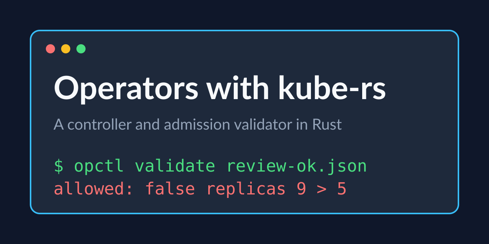

# Operators with kube-rs

A Website operator and an admission validator in Rust, tested to 100%.

Tested Rust code for the capstone of the Kubernetes and GitOps specialization: a Website custom resource, a reconciler that owns a Deployment and finalizes on delete, and validating and mutating admission logic, driven from a command-line tool.

## Examples

| example | what it does |
|---|---|
| [`src`](src) | crd, plan, validate, mutate, contract; run is the thin glue |
| [`examples`](examples) | a Website manifest and an allowed and a refused AdmissionReview |

## Prerequisites

- A Kubernetes cluster and kubectl (kind is enough)
- Rust 1.89 or newer

---

Generated — do not edit by hand. Edit `course.toml` and re-render.
